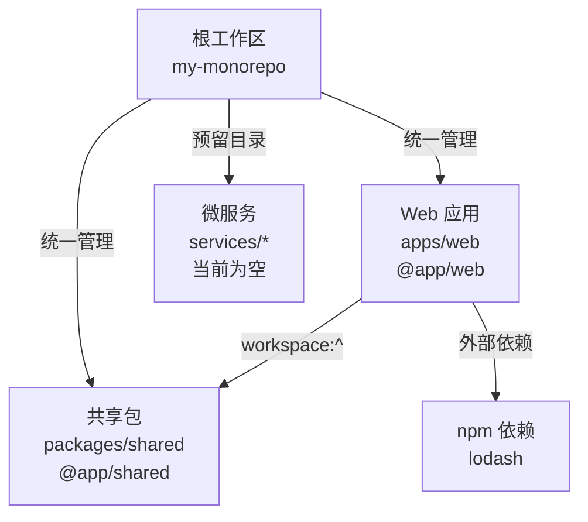

# 项目结构图

## 目录结构

```text
my_monorepo/
├── apps/                         # 可独立运行或部署的应用
│   └── web/                      # Web 应用：@app/web
│       └── package.json          # 应用配置与依赖
├── packages/                     # 跨应用复用的工作区包
│   └── shared/                   # 共享包：@app/shared
│       └── package.json          # 共享包配置
├── services/                     # 预留的微服务目录
├── AGENTS.md                     # 仓库开发与协作规范
├── PROJECT_STRUCTURE.md          # 项目结构说明
├── package.json                  # 根工作区配置及统一脚本
├── pnpm-lock.yaml                # 依赖版本锁定文件
└── pnpm-workspace.yaml           # pnpm 工作区范围配置
```

> `node_modules/` 为安装生成目录，未在结构图中展开。

## 工作区关系



## 模块职责

- `apps/web`：承载 Web 界面、路由、页面和应用级业务逻辑。
- `packages/shared`：存放跨应用共享的类型、工具函数和通用业务逻辑，不应依赖具体应用。
- `services`：用于后续拆分可独立部署的后端服务；未启用时保持为空。
- 根工作区：统一执行 `dev`、`build`、`test`、`lint` 和 `format` 等递归脚本。

新增工作区时，应将其放入 `apps/`、`packages/` 或 `services/`，提供有效的 `package.json`，并同步更新本文档中的目录树和依赖关系图。
